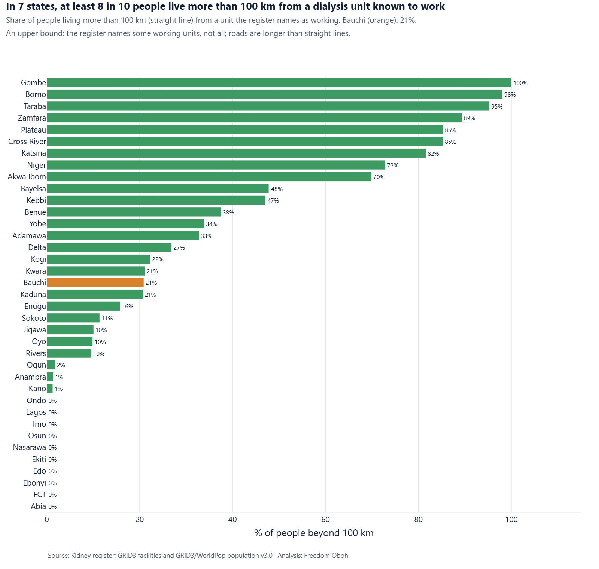
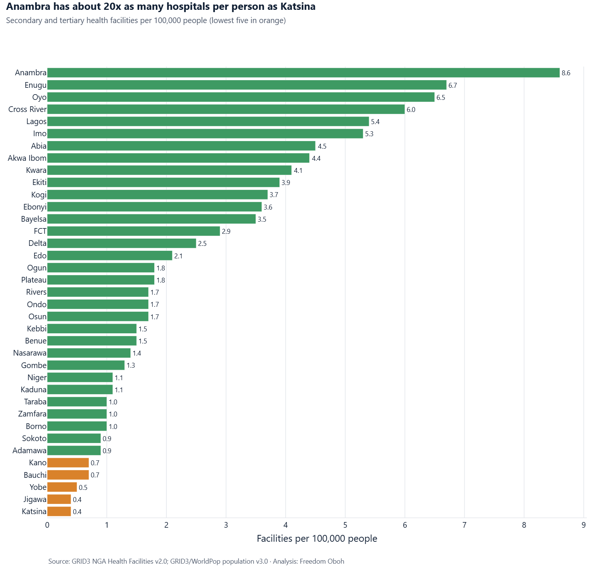
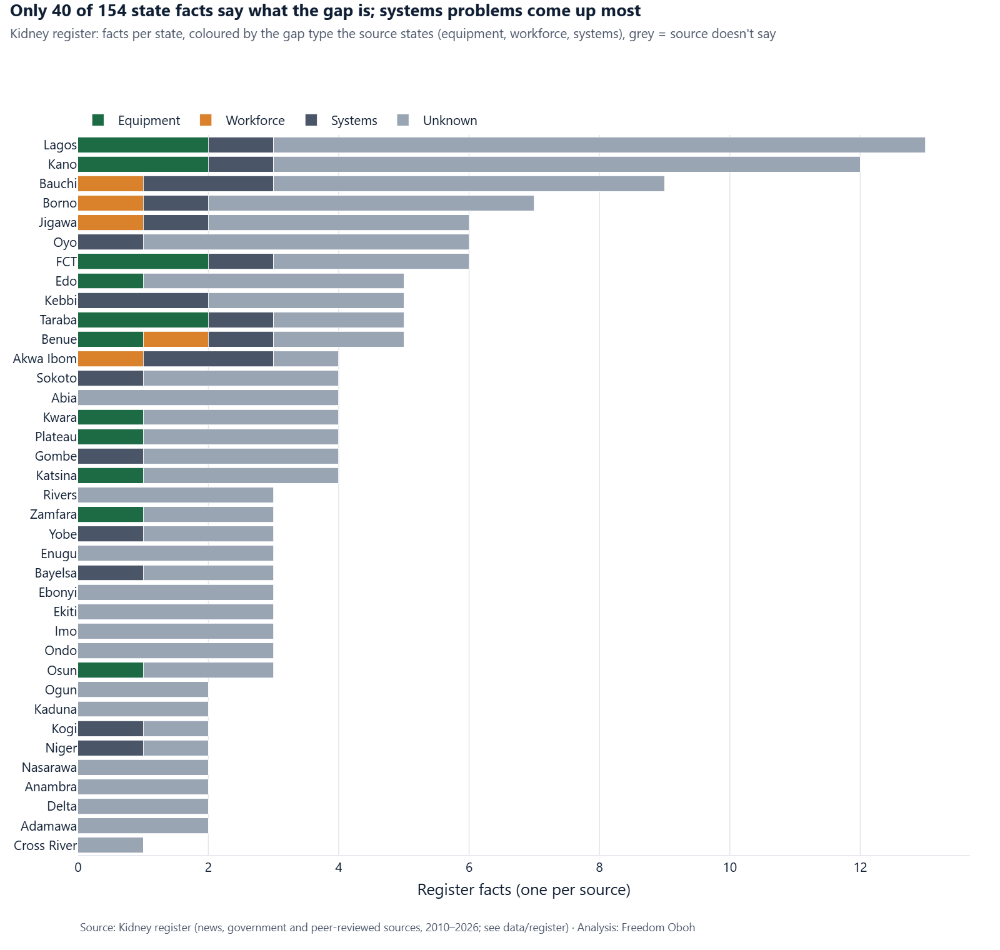
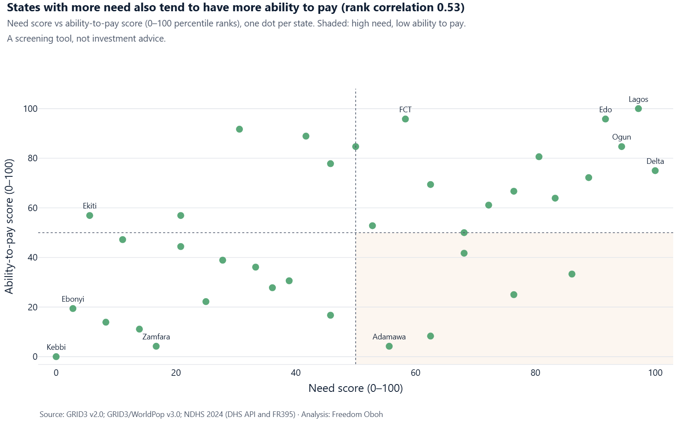
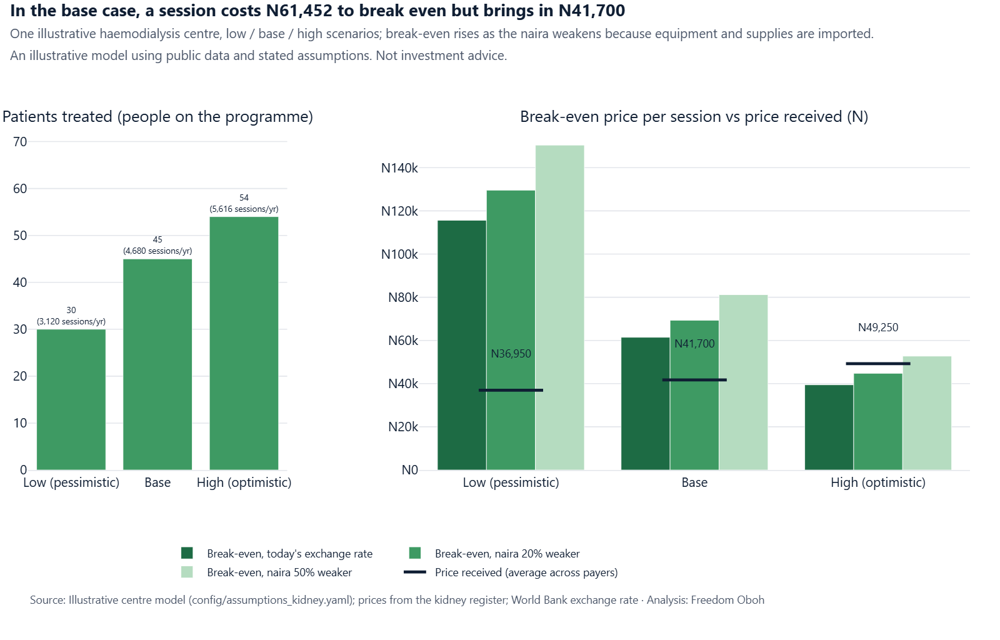
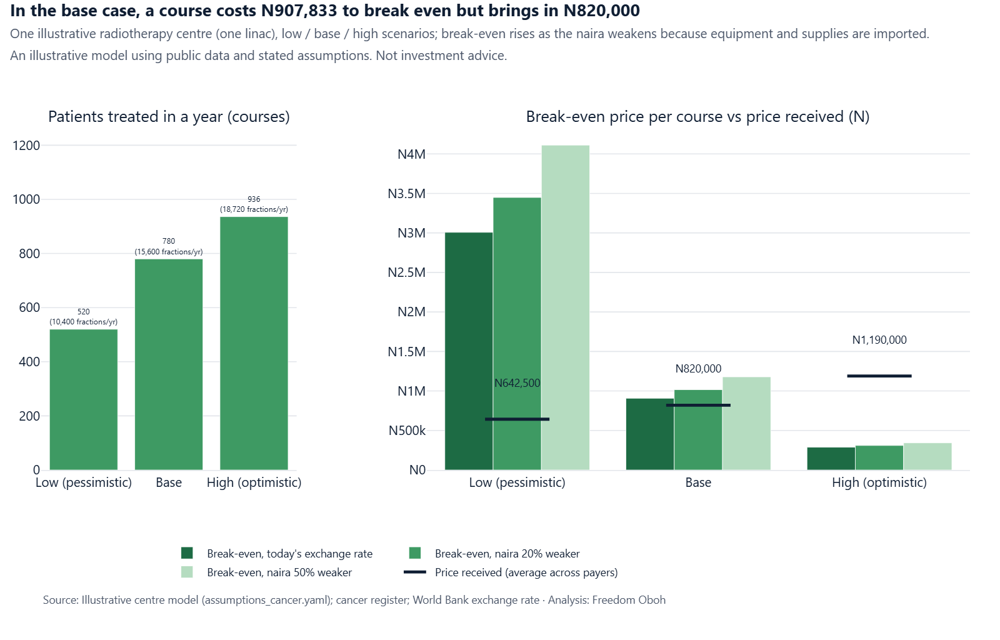
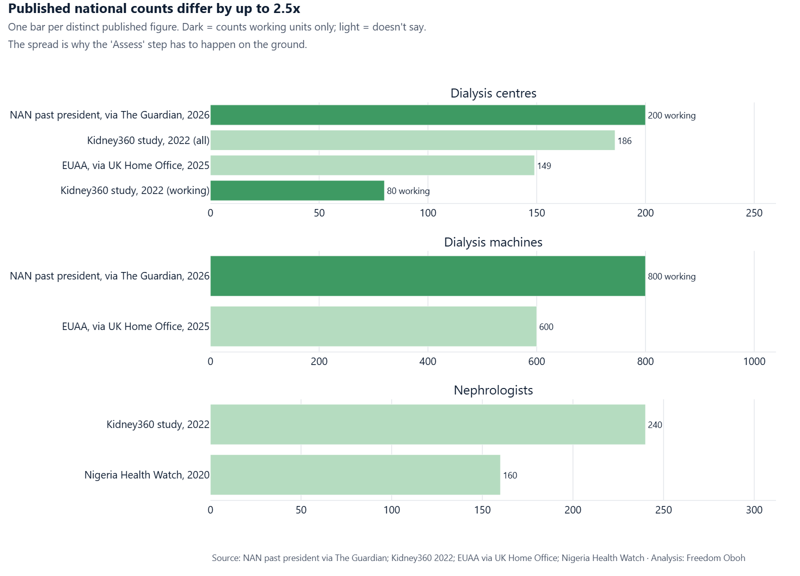
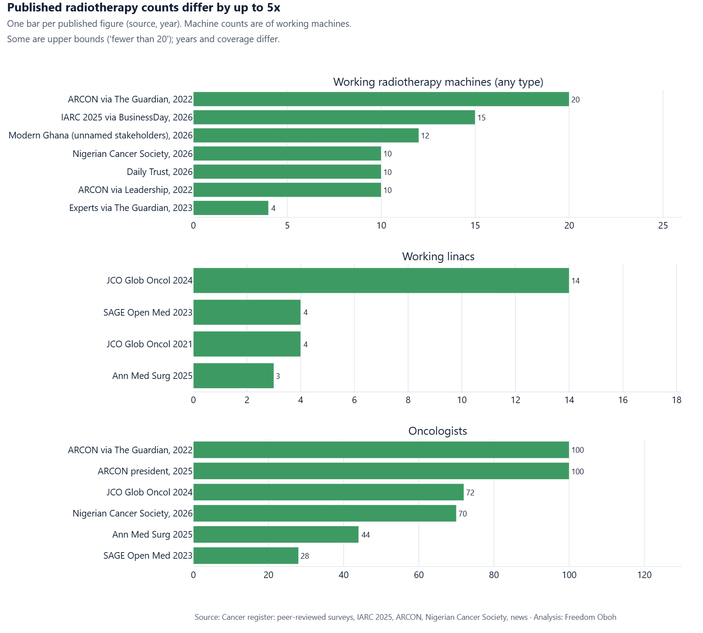

# Nigeria Health Atlas

**Where specialist care is missing in Nigeria, why it's missing, and what one centre could change.**

**Live app: https://nigeria-health-atlas.streamlit.app/**

I wanted to answer one practical question with public data: if you wanted to bring specialist care to
people who can't reach it, where in Nigeria would you look first, what is actually missing there, who can
pay, and what would one centre deliver?

I started with kidney care, because the maths of dialysis is simple: a machine, a few hours, two or three
times a week, for life. Then I did the same for cancer care (radiotherapy). Every number on this page is
filled in by code that reads dated public sources. Where sources disagree, I kept every figure.

I expected the gap to be mostly about missing machines. The data showed something messier: published counts
don't agree with each other, most sources never say why a unit isn't working, and when they do, the most
common reason is **systems** (power, water, consumables, maintenance, payment), not a missing machine.

---

## 1. The patient

**How far is Halima from a dialysis unit that works, and what does it cost her family?**

Halima is 52, a trader in Bauchi. Her kidneys have failed. Without a transplant she
needs **haemodialysis** (a machine filters her blood) 2 to 3 times a week, for life.
*Halima is an illustration, not a real person.* I chose her state from the data rather than in advance:
Bauchi ranks 10 of 37 on my scorecard, with a supply-gap score of 90 out of 100 and an
ability-to-pay score of just 25. Only 1.8% of people there have any health insurance.

The nearest units the evidence says are working are Abubakar Tafawa Balewa University Teaching Hospital and Fatima Abubakar Dialysis Centre, Hadejia. Measured in a straight line from
the middle of each local government area (LGA), half of Bauchi's people live more than
**72 km** from one, 73% live more than 50 km away, and 21% more than
100 km. Halima would make that trip 2 to 3 times a week.



She isn't the worst off. In 7 states (Gombe, Borno, Taraba, Zamfara, Cross River, Plateau and Katsina), at least 8 in 10 people live more than
100 km from a unit the register names as working. Nationally, it's 27% of people.

Then the bill. At a public hospital, a session costs about **₦45,000**, all of it paid by the family.
Two sessions a week comes to **₦4.7m a year**; three comes to ₦7m. At the ₦12,000
subsidised price available at some federal centres, it's ₦1.2m to ₦1.9m. Private hospitals
charge ₦50k–80k a session.

For scale: the national minimum wage is ₦70,000 a month (set in 2024, still the rate in October 2026 according to ThisDay). Twice-weekly dialysis at ₦45,000 a session costs 5.6 times a full year of minimum-wage pay; at the subsidised price, 1.5 times. Halima is a trader, not a wage earner, and her family's actual income is unknown, so this is a yardstick, not her budget.

And money is tight where Halima lives: in Bauchi, 61.5% of people lived below the national poverty line (₦137,430 per person per year) in 2019, against 40.1% nationally; and 73.9% were multidimensionally poor (poor in health, education and living standards, not just income) in 2022, against 63.0% nationally (NBS).

> **Under the hood.** Distances are straight lines from an LGA's centre (the middle of its health
> facilities in GRID3) to the nearest of 27 working units I could locate, in 19
> states. That makes them an *upper bound*: the register names some working units, not all, and roads are
> longer than straight lines. One unit isn't in GRID3 (the teaching hospital in Bauchi), so I used a
> hospital in the same city. Prices come from the register's cost evidence, with dates.

---

## 2. The gap

**Which states have the fewest hospitals per person?**

**Per 100,000 people** means: if the state had 100,000 people, how many hospitals would they share. I
counted secondary and tertiary facilities (general hospitals and above), where specialist care can sit.



The national figure is **2.4** per 100,000. Anambra has 8.6; Katsina has
0.4, about 21 times fewer. The five lowest are Katsina, Jigawa, Yobe, Bauchi and Kano. Bauchi has 0.7.

For dialysis specifically, my hand-built register found a public unit reported working in 19
of 37 states. In 2, the only reports say it isn't working, and in 16 there
is no evidence either way. *No evidence* is not the same as *no unit*: it means nobody I could find has written
it down.

For a decision-maker, the point is that the gap is concentrated. All 10 states with the fewest hospitals per
person are in the three northern zones. The same money buys very different coverage depending
on where it goes.

> **Under the hood.** GRID3 calls its facility list *non-exhaustive and non-validated*: it can miss,
> duplicate or keep closed facilities. I dropped 14 duplicates (same name and area, under 100 m
> apart). Against a second list (eHealth Africa), 4 states differ by more than 20%.
> Population figures are modelled (Nigeria has had no census since 2006), so I round rates to one decimal place.

---

## 3. The cause

**Is the gap equipment, workforce or systems?**

This is the question that matters most for anyone trying to fix it, and the one the data answers least.
For each fact in the register I only recorded a cause if the source states one:

- **equipment**: a broken or missing machine
- **workforce**: no nephrologist (kidney specialist) or trained dialysis nurse
- **systems**: power, water treatment, maintenance, consumables supply, referral or payment problems



Of 154 state-level kidney facts, only **40** say what the gap is. Among those, systems
problems come up 20 times, equipment 15 times and workforce 5 times. In
Bauchi, the teaching hospital's unit runs on a standby generator, and its manager put the workforce
problem plainly: "We run a morning/evening shift, and we are few." (gazettengr.com, 2025-10-06).

Cancer care looks similar. Of 64 state-level radiotherapy facts, 17 give a cause: systems
8, equipment 6, workforce 3.

What this means: buying a machine fixes one of three problems. A unit also needs steady power, clean water,
a supply chain for consumables, maintenance and trained staff, and the public evidence rarely says which one
is missing in a given place. That has to be checked on the ground, unit by unit.

> **Under the hood.** "Unknown" means the source doesn't say, not that nothing is wrong. 134 of
> 178 kidney rows and 69 of 100 cancer rows have no stated cause. 74% of the kidney
> rows come from news reports, labelled as such. 20 of 20 quotes spot-checked against
> their pages matched.

---

## 4. Who pays

**Where need is high, can people pay?**

**Out-of-pocket** means paid by the patient or family at the point of care, not through insurance or the
government. Published estimates of Nigeria's out-of-pocket share of health spending run from **58% to
75%** (4 figures, different years and methods; all on the Under the hood page). For dialysis, a
2022 survey found **98%** paid out of pocket. Only 3.9% of adults aged 15 to 49 had any health
insurance in the NDHS 2024 survey.

I built a state scorecard with three parts: **need** (people, plus self-reported high blood pressure and
blood sugar), **supply gap** (fewer hospitals per person = bigger gap) and **ability to pay** (insurance and
household wealth). Each part is a percentile rank from 0 to 100, so one extreme state can't squash the rest.

I expected the states with the greatest need to have the least ability to pay. The data showed something
more specific.



Need and ability to pay actually move *together* (rank correlation **+0.53**; +1 would mean the two
rankings line up exactly). Part of that is how need is measured: diagnoses are self-reported, and people who
can pay get tested more. But the **supply gap** moves the other way: rank correlation **−0.52**. The
states with the fewest hospitals are the least able to pay. 5 states sit in the high-need,
low-ability-to-pay corner, including Bauchi.

That is the tension that makes public-private partnerships (PPPs) relevant: a **PPP** is an arrangement where
a private partner and a public hospital share the investment, the work and the money. Where patients can't
pay the full price, someone else has to: insurance, a subsidy or a long-term investor.

With equal weights, the top five states are Kano, Edo, Ogun, Delta and Ondo; the bottom five are Ekiti, Cross River, Enugu, Kebbi and Ebonyi. I re-ran the score
319 times with different weights, and 9 states stay in the top 10 in at least 80% of runs:
Kano, Edo, Ogun, Ondo, Rivers, Kaduna, Nasarawa, Delta and Lagos.

> **Under the hood.** A screening tool, not investment advice. The out-of-pocket share is national only; I
> never spread it across states. NDHS state figures are survey estimates with margins of error. With need
> measured by population alone, 8 of the top 10 stay the same.

---

## 5. What a centre could do

**What would one dialysis centre in a high-gap state deliver?**

I modelled one illustrative centre inside a public hospital: 10 machines, two shifts, six days a
week. **Capacity used** is the share of available session slots actually filled. The **payer mix** is who
pays for each session (family, subsidy, insurance, employer).



In the base case it treats **45 people** (4,680 sessions a year) at 75% capacity used.
But the money doesn't add up at public prices. It receives about **₦41,700** a session on average and needs
**₦61,452** to break even. Consumables, power and water alone cost ₦36,368 a session, because
dialysers and bloodlines are imported and priced in dollars (1,518 naira per US$, World Bank 2025).
It loses about ₦92.4m a year. Only the optimistic scenario pays back its ₦607m set-up cost, in about
8 years, and a naira 20% weaker stretches that to 20 years.

I also tested two general PPP structures (illustrative only, not any real organisation's terms): a fee per
session paid to the partner, or a revenue share. They move the shortfall between the partner (about
₦2.6m a year) and the hospital (−₦95m); they don't remove it. Closing the gap needs a higher
tariff, a larger insured or subsidised share at a fuller price, cheaper supplies, or outside funding.

**And cancer care?** One radiotherapy centre with a single **linac** (linear accelerator, the machine that
delivers radiation) could treat about **780 patients a year** (15,600 daily treatments). It
receives about ₦820,000 a course and needs ₦907,833; it covers its running costs once 87% of
its slots are filled. It is closer to viable than the dialysis centre, but its ₦4.6bn set-up cost is far
larger, and the optimistic case pays back in about 4 years.



> **Under the hood.** An illustrative model using public data and stated assumptions. Not investment advice.
> 14 of 21 dialysis inputs (and 11 of 22 radiotherapy inputs) are still
> assumptions to verify. The input that moves the dialysis result most is consumables per session (US$), which
> is an assumption with no public source yet. For radiotherapy it's maintenance % of equipment per year. Both models are checked against a case worked by hand.

---

## 6. The honest limits

**Where is the data thin, and where do sources disagree?**



- **Dialysis centres:** published national counts run from 80 to 200+, a
  2.5-fold spread.
- **Radiotherapy machines:** published counts of *working* machines run from 4 to 'fewer than 20',
  against an estimated 120 needed (IARC 2025 via BusinessDay). My register can name 10 working
  machines, in 5 states; 16 of 37 states have any radiotherapy evidence
  at all.
- **Causes:** most sources don't say why a unit isn't working.
- **People:** population is modelled, not counted. Population aged 40 and over, which I wanted as a measure
  of kidney-disease risk, isn't published by state, so need uses total population.
- **Money:** Nigeria has no published average household income, so I use the minimum wage and poverty rates
  as yardsticks.

The spread between counts is itself a finding. Before any money moves, someone has to visit each unit and
check what works, what doesn't, and why. Public data can tell you where to look first. It can't do that check.



---

## How it's built

```
config/         centre-model assumptions (value, range and source for every input) and story settings
data/raw/       untouched downloads, dated
data/manual/    hand-entered tables, with page numbers or source URLs
data/register/  the hand-built specialist register (one row per fact, per source)
data/lookups/   state names as each source spells them; facility levels; dialysis unit locations
data/processed/ what the app reads
pipeline/       fetch, clean, join, score, model, validate (python pipeline/run_all.py)
src/            scoring, centre model, charts, story numbers
story/          this page's template: every number is a placeholder filled by code
app/            the Streamlit app (seven pages)
notebooks/      one walk-through notebook per phase
exports/        the chart pack (PNG) and tables
```

```bash
pip install -r requirements.txt
python pipeline/run_all.py        # fetch -> clean -> join -> score -> model -> charts -> story -> validate
streamlit run app/Home.py
python -m pytest
```

A GitHub Action re-runs the pipeline every Monday and commits only when a source has published something new.

**Sources:** GRID3 health facilities and population (with WorldPop), the Nigeria Demographic and Health
Survey 2024, the World Bank, the Central Bank of Nigeria, the National Bureau of Statistics, geoBoundaries,
and hand-built registers of dialysis and radiotherapy capacity from peer-reviewed, government and news
sources. Full list, with licences and access dates, in [`data/sources.yaml`](data/sources.yaml) and on the app's
Under the hood page. Code: MIT licence. Data: each source keeps its own licence.

Freedom Oboh · data analyst, Lagos · numbers as of 2026-11-24

**This is a learning project using public data. It is not investment, medical or financial advice.**
